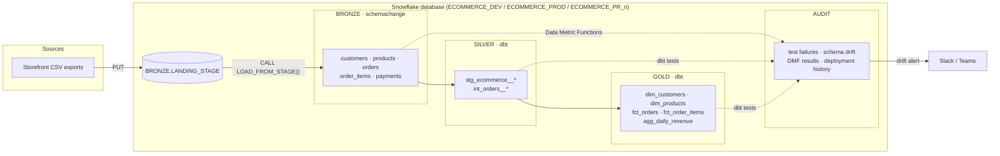
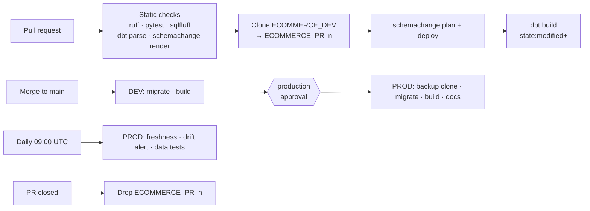

# Snowflake schemachange + dbt: e-commerce lakehouse

A production-style reference project that shows how to split responsibilities on
Snowflake:

- **[schemachange](https://github.com/Snowflake-Labs/schemachange)** owns the
  database objects: schemas, landing tables, file formats, stages, stored
  procedures, Data Metric Functions and grants, as versioned migrations.
- **[dbt](https://www.getdbt.com/)** owns the transformations: a medallion
  architecture (BRONZE → SILVER → GOLD) with tests, contracts and docs.
- **GitHub Actions** ties them together: static checks, an isolated zero-copy
  clone per pull request, gated DEV → PROD deployments and daily monitoring.

Python tooling is managed with [uv](https://docs.astral.sh/uv/).

## Architecture



| Layer    | Owner        | Content                                                                 |
| -------- | ------------ | ----------------------------------------------------------------------- |
| `BRONZE` | schemachange | Source-shaped landing tables with lineage columns (`_source_file`, `_loaded_at`) |
| `SILVER` | dbt          | Typed, cleaned, deduplicated entities; `stg_ecommerce__orders` is incremental |
| `GOLD`   | dbt          | Dimensional models with enforced contracts, granted to `ECOMMERCE_READER` |
| `AUDIT`  | both         | Stored test failures, schema drift, DMF results, schemachange history    |

Environments are isolated by **database**, not schema, so every environment has
the same `BRONZE`/`SILVER`/`GOLD`/`AUDIT` layout.

## Repository layout

```
bootstrap/                 One-time account setup (roles, warehouse, databases, service user)
schemachange/
  schemachange-config.yml  config-version 2; connection comes from SNOWFLAKE_* env vars
  modules/                 Shared Jinja macros
  scripts/versioned/       V<x.y.z>__*.sql  applied once, in order
  scripts/repeatable/      R__*.sql         re-applied when their content changes
  scripts/always/          A__*.sql         applied on every deployment (grants)
dbt/
  models/silver/           Sources (BRONZE), staging and intermediate models
  models/gold/             core (dims/facts) and finance (aggregates)
  models/audit/            Schema snapshot history and drift view
  tests/generic|singular/  Custom data quality tests
ops/                       Python tooling: sample data, loading, clones, drift alerts
tests/                     pytest suite for ops/
.github/                   Workflows, composite setup action, Dependabot, CODEOWNERS
docs/                      Runbook and data quality reference
```

## How schemachange is used

| Script                                        | Type       | Demonstrates                                    |
| --------------------------------------------- | ---------- | ----------------------------------------------- |
| `V1.0.0__create_medallion_schemas.sql`        | versioned  | Schema creation                                 |
| `V1.1.0__create_bronze_tables.sql`            | versioned  | Jinja module import (`modules/bronze.sql`)      |
| `V1.2.0__create_bronze_ingestion_objects.sql` | versioned  | File format and internal stage                  |
| `V1.3.0__add_customer_marketing_consent.sql`  | versioned  | Schema evolution (`ALTER TABLE ... ADD COLUMN`) |
| `V1.4.0__create_data_quality_metrics.sql`     | versioned  | Custom + system Data Metric Functions, feature flag via vars |
| `R__bronze_load_procedure.sql`                | repeatable | Stored procedure generated from a Jinja macro   |
| `R__audit_views.sql`                          | repeatable | Views over change history and DMF results       |
| `A__grants.sql`                               | always     | Converging privileges, including on clones      |

The change history table lives in each database (`<DB>.SCHEMACHANGE.CHANGE_HISTORY`).
A pull request clone therefore inherits DEV's history and only applies the
migrations introduced by that pull request, which is exactly what PROD will run
after the merge.

## Data quality

Data quality checks run in layers. See [docs/data-quality.md](docs/data-quality.md) for the full list.

1. **Snowflake Data Metric Functions** on BRONZE tables: null, duplicate and
   freshness counts, plus custom `INVALID_EMAIL_COUNT` and `NEGATIVE_VALUE_COUNT`.
2. **Source tests and freshness** on BRONZE (severity `warn`: raw data is reported, not blocked).
3. **SILVER/GOLD data tests**: uniqueness, referential integrity, accepted
   values, ranges, regex, row-count parity, business rule expressions
   (`dbt_utils`, `dbt_expectations` and custom generic tests).
4. **Singular tests**: revenue reconciliation, payment consistency, schema drift.
5. **Unit tests** for business logic (`fct_orders` totals, customer segmentation).
6. **Model contracts** on every GOLD model (column names, types, not null).
7. **Schema drift audit**: `INFORMATION_SCHEMA` vs dbt source declarations,
   alerting Slack/Teams.

Failing rows of every test are stored in `AUDIT` (`store_failures`).

## CI/CD



| Workflow        | Trigger              | What it does                                                         |
| --------------- | -------------------- | -------------------------------------------------------------------- |
| `ci.yml`        | pull request         | Offline checks; then migrations and slim `dbt build` on a zero-copy clone |
| `deploy.yml`    | push to `main`, manual | DEV, then PROD behind the `production` environment; dbt docs as a downloadable artifact |
| `scheduled.yml` | daily, manual        | Source freshness, schema drift alert, full data test suite on PROD   |
| `pr-cleanup.yml`| pull request closed  | Drops the pull request database                                       |

All actions are pinned to commit SHAs; Dependabot keeps them and the `uv.lock` up to date.

## Getting started

Requirements: [uv](https://docs.astral.sh/uv/), a Snowflake account (Enterprise
edition for Data Metric Functions) and an admin user for the one-time bootstrap.

```bash
make install                 # uv sync, dbt deps, pre-commit hooks
cp .env.example .env         # fill in account, user and key path
make lint test-python        # everything that runs without Snowflake
```

With Snowflake access (see [docs/runbook.md](docs/runbook.md) for key-pair setup and bootstrap):

```bash
make migrate-plan            # schemachange dry run
make migrate                 # apply migrations to $SNOWFLAKE_DATABASE
make sample-data             # generate and load synthetic data into BRONZE
make build                   # dbt build: models, data tests, unit tests
make drift                   # schema drift report
make docs                    # dbt docs on localhost
```

Generate broken data on purpose to watch the data quality tests react:

```bash
uv run python -m ops.generate_sample_data --inject-anomalies
```

## GitHub configuration

| Kind        | Name                                | Value                                         |
| ----------- | ----------------------------------- | --------------------------------------------- |
| Variable    | `SNOWFLAKE_ACCOUNT`                 | `<org>-<account>`; workflows that need Snowflake are skipped while empty |
| Variable    | `SNOWFLAKE_USER`                    | `SVC_ECOMMERCE_CICD`                          |
| Variable    | `ENABLE_DATA_METRIC_FUNCTIONS`      | `false` on Standard edition (default `true`)  |
| Variable    | `FRESHNESS_BLOCKING`                | `true` to fail the scheduled run on stale sources |
| Secret      | `SNOWFLAKE_PRIVATE_KEY`             | PKCS#8 private key (PEM)                       |
| Secret      | `SNOWFLAKE_PRIVATE_KEY_PASSPHRASE`  | Key passphrase, if encrypted                   |
| Secret      | `SCHEMA_ALERT_WEBHOOK_URL`          | Slack or Teams incoming webhook (optional)     |
| Environment | `ci`, `dev`, `production`, `production-monitoring` | Add required reviewers to `production` |

## License

[MIT](LICENSE)
